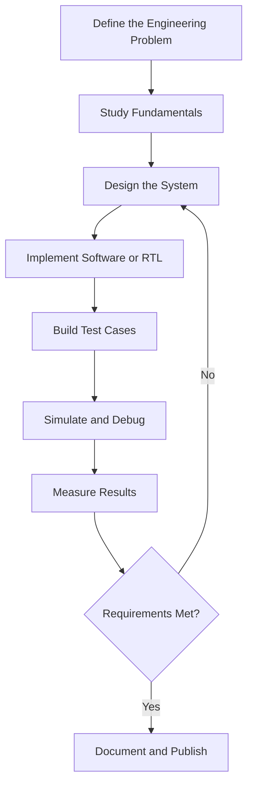

 

  
  
  
  

**AI Systems • VLSI • FPGA • Embedded Firmware • Edge AI**

---

## 👨‍💻 About Me

I’m drawn to the space where **intelligence meets silicon** — turning algorithms into systems that don’t just think, but execute efficiently in the real world.

From exploring how neural networks can be accelerated in hardware to experimenting with RISC-V, FPGA architectures, and embedded firmware, I’m interested in engineering the layers beneath intelligent computing.

- 🧠 **AI & Algorithms** — Exploring how machines learn, infer, and make decisions.
- ⚡ **Silicon & Logic** — Translating computational ideas into digital hardware.
- 🔬 **Edge Intelligence** — Bringing AI closer to devices, with efficiency in mind.
- 🔧 **Firmware & Architecture** — Connecting software instructions to hardware behavior.
- 🚀 **Hardware–Software Co-Design** — Finding the balance between intelligence, performance, and resource constraints.

**The direction I’m building toward:** Engineering intelligent systems from the algorithm down to the architecture — where every computation, clock cycle, and resource matters.

## 🧭 Quick Navigation

- [Engineering Roles](#-engineering-roles)
- [Technical Stack](#-technical-stack)
- [Featured Projects](#-featured-projects)
- [Engineering Workflow](#-engineering-workflow)
- [Current Learning Roadmap](#-current-learning-roadmap)
- [GitHub Statistics](#-github-statistics)
- [Connect With Me](#-connect-with-me)

---

## 🎯 Engineering Roles

These are the engineering areas I am exploring and working toward. They describe my career interests, not claims of current employment or professional-level proficiency.

### 🧠 AI Systems / Machine Learning Engineer

**Focus:** Building machine learning systems that solve practical problems and can be evaluated, integrated, and deployed.

- Data preprocessing and feature engineering.
- Model training, validation, and performance evaluation.
- Classification, anomaly detection, and inference pipelines.
- Integrating ML models into Python applications and APIs.
- Exploring model optimization for resource-constrained devices.

**Technologies:** Python, NumPy, pandas, scikit-learn, PyTorch, TensorFlow.

### ⚡ FPGA / Digital Design Engineer

**Focus:** Designing and verifying digital circuits, then exploring how they can accelerate computational workloads.

- RTL design using Verilog.
- Combinational and sequential digital logic.
- Simulation, testbenches, and waveform debugging.
- FPGA prototyping and synthesis workflows.
- Exploring parallel computation and AI accelerator architectures.

**Technologies:** Verilog, AMD Vivado, FPGA development boards, digital logic, RISC-V concepts.

### 🔧 Embedded Firmware Engineer

**Focus:** Developing low-level software that connects hardware peripherals, sensors, processors, and real-time system behavior.

- C programming and embedded programming fundamentals.
- GPIO, UART, I²C, SPI, and peripheral interfaces.
- Sensor acquisition and device communication.
- Firmware debugging and simulation.
- Exploring runtime monitoring and firmware security.

**Technologies:** C, ESP32, Arduino, RISC-V concepts, Renode, serial communication.

### 💻 Software / Backend Engineer

**Focus:** Building reliable backend services and APIs that connect applications, databases, and intelligent systems.

- Python application development and REST APIs.
- Java and object-oriented programming.
- SQL and relational database fundamentals.
- API integration and structured data validation.
- Testing, Git workflows, and deployment fundamentals.

**Technologies:** Python, Java, FastAPI, Flask, PostgreSQL, MySQL, Git, Docker.

---

## 🛠️ Technical Stack

### Programming Languages

  

- **Python:** scripting, data processing, and machine learning projects.
- **C:** embedded programming and low-level software fundamentals.
- **Java:** object-oriented programming and software engineering practice.
- **Verilog:** digital logic design and RTL experimentation.

### AI, Machine Learning & Data

  
  
  
  

- Machine learning fundamentals and model evaluation.
- Classification and anomaly detection.
- Feature engineering and data preprocessing.
- Exploring deep learning and edge inference.
- Learning efficient AI deployment on constrained hardware.

### VLSI, FPGA & Embedded Systems

  
  
  
  
  
  

- Digital logic design and RTL development.
- FPGA-based hardware prototyping.
- Processor and accelerator architecture fundamentals.
- Embedded firmware and sensor integration.
- Simulation-based debugging and verification.

### Backend, Databases & APIs

  

- REST API development and integration.
- Data storage and SQL fundamentals.
- Python backend applications.
- Model serving and application integration.
- Exploring containerization and deployment.

### Developer Tools & Platforms

  

- Git and GitHub for version control.
- Linux and Ubuntu development environments.
- VS Code and command-line workflows.
- Simulation, debugging, and project documentation.

Technology lists represent a combination of hands-on use, project experience, and ongoing learning. They do not imply equal proficiency across every tool.

---

## 🚀 Featured Projects

### 1. AI-Assisted Firmware Runtime Monitor

**Machine Learning · Embedded Systems · RISC-V · Firmware Security**

An experimental firmware-monitoring project exploring whether execution-related feature vectors can be classified as normal or abnormal using a machine learning model.

**Key work**
- Trained a Random Forest classifier using trace-derived feature data.
- Explored a Python training workflow and C-side inference.
- Investigated deployment concepts for a bare-metal RISC-V environment.
- Used Renode as part of the simulation workflow.

**Reported experimental results**
- 7 input features.
- 100 decision trees in the Random Forest model.
- 4,059 held-out test windows, with 4,053 classified correctly.
- Approximately 99.85% accuracy on that test set.
- 3,192/3,192 matching predictions in a Python-versus-C inference comparison.

**Important limitations:** These figures describe the available test data and implementation. Matching Python and C predictions does not independently establish model correctness or security effectiveness. They do not demonstrate live trace collection, detection of real-world attacks, physical hardware deployment, or real-time performance.

**Repository:** [AI-Assisted Firmware Runtime Monitor](https://github.com/dineshraja-dr/AI-Assisted-Firmware-runtime-monitor)

**Future directions**
- Integrate runtime feature collection.
- Expand testing with varied normal and abnormal execution scenarios.
- Measure inference latency and memory footprint.
- Investigate actionable alerts and safe-mode behavior.

### 2. AI Inference Accelerator — FPGA / RISC-V Exploration

**Verilog · Digital Design · FPGA · Edge AI**

An engineering exploration of how neural-network computations can be mapped onto digital hardware, with an emphasis on hardware-software co-design.

**Areas of focus**
- RTL design and digital logic fundamentals.
- Parallel arithmetic and computation-oriented hardware structures.
- Understanding the relationship between quantization and inference efficiency.
- Exploring accelerator integration with processor-based systems.
- Learning how hardware resources, latency, and throughput influence AI deployment.

**Engineering goals**
- Develop synthesizable Verilog modules.
- Build self-checking testbenches.
- Validate functional behavior through simulation.
- Evaluate synthesis results when supported by the implementation flow.
- Compare software reference outputs with hardware outputs.

**Repository:** [Browse my GitHub repositories](https://github.com/dineshraja-dr?tab=repositories)

*The project description outlines the engineering direction; report only verified implementation, synthesis, and performance results as completed achievements.*

### 3. ESP32 Predictive Maintenance Using a Virtual Sensor

**ESP32 · Python · Machine Learning · Predictive Maintenance**

A predictive-maintenance project that explores the use of sensor data and machine learning to identify patterns associated with potential equipment failures.

**Key work**
- Explored the AI4I 2020 predictive-maintenance dataset.
- Used Python and scikit-learn for model development.
- Connected the project concept to ESP32-based monitoring.
- Developed a Flask-based workflow for CSV input and model inference.
- Explored the relationship between sensor measurements, machine condition, and failure prediction.

**Engineering concepts**
- Data preprocessing and feature selection.
- Classification and model evaluation.
- Sensor-to-software integration.
- Model serialization and application inference.
- Monitoring workflows for industrial equipment.

**Repository:** [PDM Virtual Sensor — ESP32](https://github.com/dineshraja-dr/PDM-Virtual-Sensor-ESP32)

*Dataset-based performance and simulated sensor behavior should be distinguished from results collected through real equipment trials.*

---

## 🔄 Engineering Workflow

My preferred approach is to move from a clearly defined problem to a tested implementation, rather than relying only on a project demonstration.

For AI-and-hardware projects, the workflow also includes comparing reference outputs, checking implementation constraints, and recording the limitations of each experiment.

---

## 📚 Current Learning Roadmap

My learning roadmap connects software fundamentals with AI and hardware implementation.

- [ ] Strengthen Python fundamentals, functions, OOP, and testing.
- [ ] Practice data structures and algorithms consistently.
- [ ] Improve SQL and relational database fundamentals.
- [ ] Build reliable REST APIs using FastAPI or Flask.
- [ ] Strengthen Verilog RTL, simulation, and testbench design.
- [ ] Learn FPGA synthesis and timing-analysis fundamentals.
- [ ] Study machine learning evaluation and deep learning fundamentals.
- [ ] Explore quantization and efficient edge inference.
- [ ] Improve embedded C, peripheral communication, and firmware debugging.
- [ ] Publish reproducible projects with documentation, tests, and measured results.

**Long-term goal:** Build a strong foundation in AI systems and hardware-software co-design, then apply it to efficient edge intelligence and AI acceleration.

---

## 📊 GitHub Statistics

Statistics and widgets are provided by third-party services and may be unavailable temporarily. Language statistics reflect repository contents, not necessarily proficiency.

---

## 🤝 Connect With Me

I am interested in connecting with students, engineers, researchers, and teams working on AI systems, VLSI, FPGA, embedded firmware, edge computing, and hardware acceleration.

---

### Building at the intersection of AI and hardware.

**Learn • Design • Implement • Verify • Improve**

